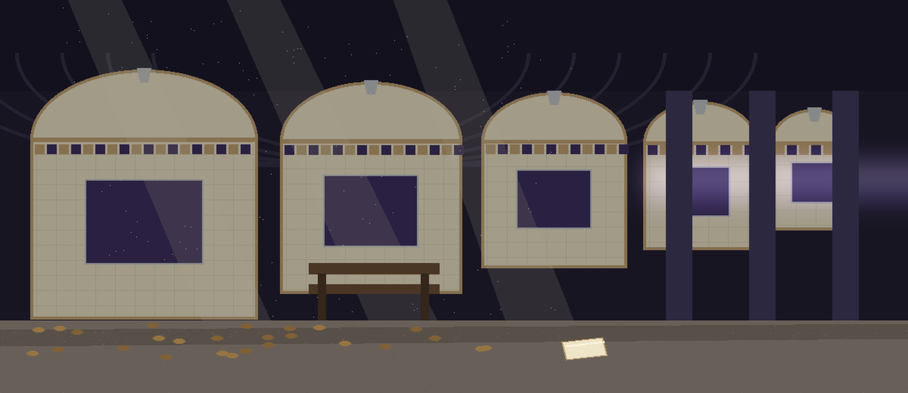
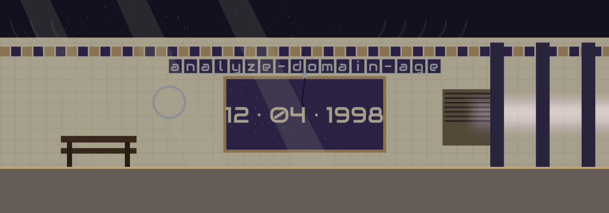

# analyze-domain-age




# analyze-domain-age
Determines the age of a domain name using WHOIS lookups with the `python-whois` library.

## Install
```
git clone https://github.com/ShadowGuard-AI/analyze-domain-age
cd analyze-domain-age
pip install -r requirements.txt
```


## Usage
```
python3 main.py DOMAIN [-o OUTPUT] [-v]
```


## Parameters
- `DOMAIN`: the domain name to analyze, for example `example.com`.
- `-h`: show help message and exit.
- `-o`, `--output`: optional output file to save results in CSV format.
- `-v`, `--verbose`: enable verbose logging.


## Verified behavior
- On success the tool prints the domain, its creation date, the current date, and the age in days.
- A domain without a dot is rejected and exits 1.
- A failed WHOIS lookup exits 1.
- With `-o`, the result is written as one CSV row with the domain, creation date, current date, and age in days.
- Live run not possible in this environment: the `whois` package is not installed here and installs are not permitted in this wave, and a live WHOIS lookup is outside the allowed network hosts. The parameter list above is taken from the argument parser in `main.py`, and the file compiles cleanly.


## License
MIT License, see LICENSE.

> Shuttered window note: the two refusal cases sit in the open in the Verified behavior section: a domain without a dot exits 1, and a failed WHOIS lookup exits 1. The same section states plainly that a live run was not possible in the documenting environment.
